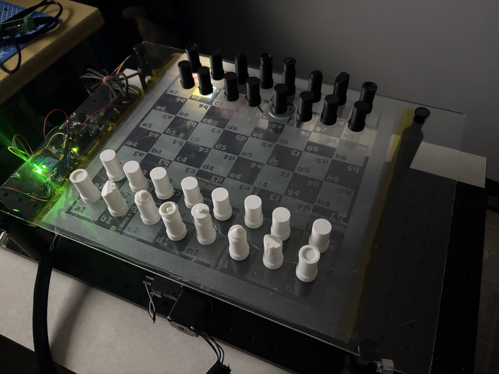
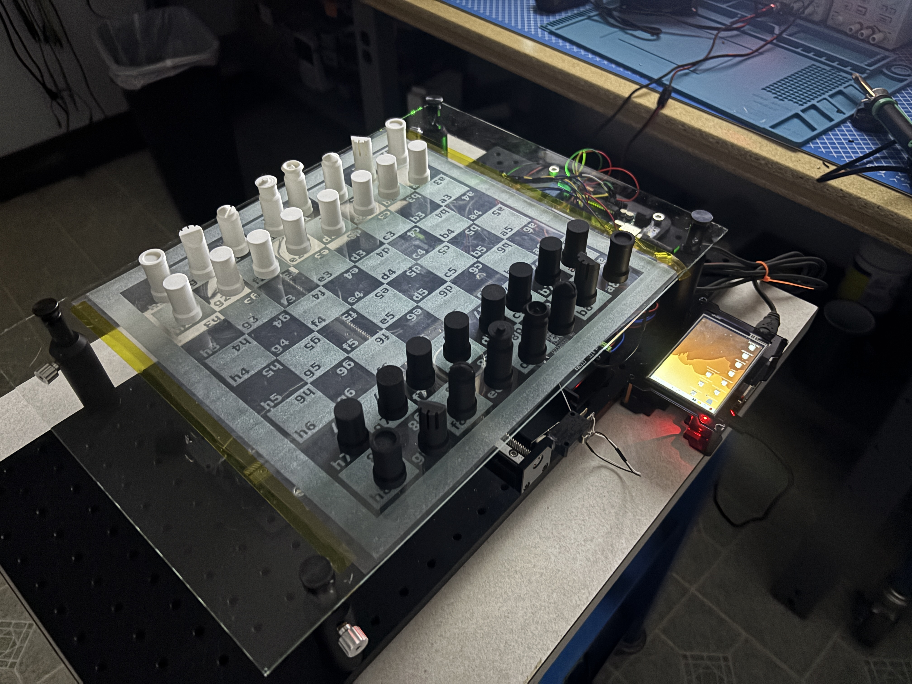
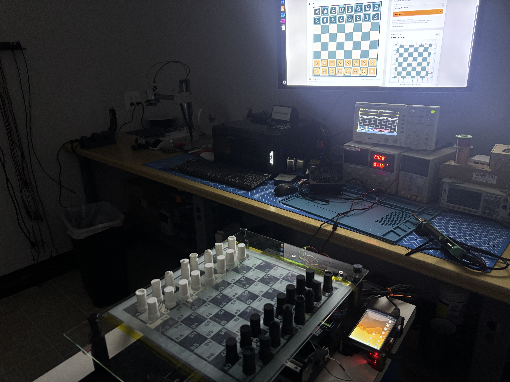
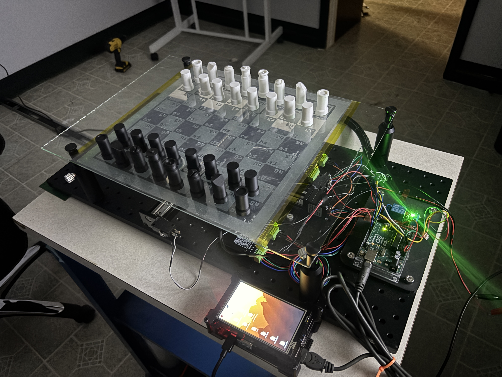

# Chess Table

Automated chessboard with a Python host, Arduino Uno motor controller, and 32 perimeter parking slots.

**The board has no piece sensors.** Inspect and reconcile uncertain motion before continuing. Preserve checkpoints and serial logs in `computer/runs/`.

## Photos and demos

| Board and pieces | Board with display |
| --- | --- |
|  |  |
| **Desktop GUI setup** | **Motors and controller wiring** |
|  |  |

Videos: [PocketMage control demo](docs/media/pocketmage-chess.mp4) · [Automatic play demo](docs/media/pocketmage-chess-auto.mp4).

## Run

Complete the [one-time setup](docs/QUICK_START.md#once-per-machine), then run from the repository root:

```powershell
.\Play-ChessTable.ps1                # Physical table
.\Start-ChessTable.ps1 -EnableAina   # Simulation
```

```bash
./Play-ChessTable.sh                # Physical table
./Start-ChessTable.sh --enable-aina # Simulation
```

Open `http://localhost:8765/`, choose a mode, and start the game. Launching the host alone does not move pieces. See the [quick start](docs/QUICK_START.md) for local-only play, resume, USB, and recovery.

## Guides

- [Host development](computer/README.md) and [Uno firmware](firmware/README.md)
- [Architecture](docs/ARCHITECTURE.md), [routing](docs/ROUTING.md), and [serial protocol](docs/PROTOCOL.md)
- [Aina setup and API](docs/REMOTE_AINA.md)
- [PocketMage control and LAN API](docs/POCKETMAGE_CONTROL.md)
- [Accepted work and remaining tests](docs/ROADMAP.md)

The original `chess_automated` application remains in Git history. Its [MIT notice](LICENSES/chess_automated.txt) credits WouterSchols; the current host and imported firmware are maintained separately.
