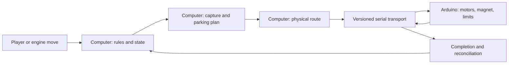

# Architecture and ownership

## Guiding boundary

The computer owns **what should happen** in a game. The Arduino owns **how to execute one bounded physical operation safely**. Neither side should silently assume a motor command proves that a piece arrived. Until sensors are added, an operator must confirm discrepancies and restore a known position after a fault or reboot.

| Concern | Computer program | Arduino firmware |
| --- | --- | --- |
| Chess rules | Maintain authoritative `python-chess` board and legal moves, including captures, castling, en passant, promotion, game end. | No rule engine. Reject malformed or unsupported physical commands. |
| Piece and parking inventory | Track piece type, color, location, captured pieces, and assigned slots 00–31. Decide which free slot receives a capture. Persist/reconcile game state. | Keep only compact occupancy or operation state needed for motion guards. No piece identity or slot policy. |
| Motion planning | Convert a legal move into ordered physical operations. Plan collision-aware routes using measured board geometry and known occupancy. Remove a captured piece before carrying the attacker. | Execute one validated route/segment at a time, control X/Y steppers and magnet, enforce travel bounds and active limits, and report progress/faults. |
| Calibration | Request calibration and record the geometry/version used for planning. Require a referenced carriage before dispatch. | Home/reference switches, measure span, map squares and parking coordinates, save compatible geometry in EEPROM. |
| Communications | Open/configure serial, negotiate capabilities, assign command IDs, wait for ACK and completion, time out, record events, and reconcile after uncertainty. | Parse framed commands, reject busy/invalid requests, associate every response with its ID, report boot/fault/completion, and hold a safe state on stop/fault. |
| Player and engine | Provide input, chess engine/online adapters, clock/UI, and confirmation prompts. | No engine or user account logic. |
| Physical truth | Compare expected state with sensor data when hardware exists; otherwise require manual move entry and confirmation at defined checkpoints. | Report switch/motion/magnet state. A completed step count is not a piece-presence measurement. |

## Operation order

1. The computer validates a proposed UCI move against its current board.
2. It creates a logical plan. A capture first moves the victim to an available parking slot; en passant uses the pawn's actual square. Castling requires two carries. Promotion requires an explicit physical piece-exchange policy.
3. A physical route planner checks the current `GEOM` calibration and occupied locations, then selects a route within the Uno's 12-waypoint `CARRY` limit. The software can express square-to-square and square-to-perimeter transfers; loaded hardware clearance remains to be validated.
4. The computer sends one bounded command, waits for an ID-matched completion, and records the outcome. A timeout, reset, stop, or fault marks the physical state **uncertain**; software must not advance the authoritative game position automatically.
5. When all operations and any required physical confirmation complete, the computer commits the chess move and updated parking inventory together.

## Parking geometry

The firmware maps 32 perimeter grid intersections: 00–08 along the bottom, 09–17 along the top, 18–24 on the left, and 25–31 on the right. Each slot can hold one piece. A `CARRY` route can bring an interior captured piece to a reachable slot through grid intersections; the host must account for other pieces and the magnet's real clearance. The firmware bitmap represents commanded occupancy for 64 squares plus 32 slots, not sensed occupancy or identity.

## Recovery contract

EEPROM retains measured geometry, not the carriage's live position or the game inventory. After power loss, motor stop, or interrupted carry: release the magnet safely, reference the carriage, inspect/reconcile every moved piece and occupied parking slot, restore the computer and firmware maps to the same physical position, and only then resume. A software-only replay is unsafe because the firmware cannot tell whether pickup or release succeeded.
